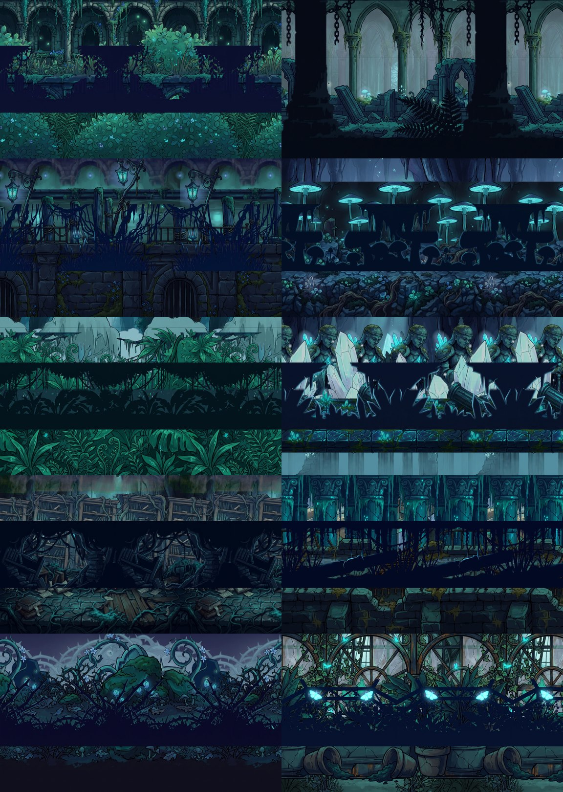

# Painted Parallax asset pack

Ten painted parallax backgrounds for the Metroidvania Developer System (MDS), in dark teal and navy: overgrown ruins, glowing fungus, crystal shrines, flooded halls and greenhouses. Each is an `MDSParallaxBackground` scene whose layers are pictures (`MDSParallaxLayer`, kind **Picture**), so they work anywhere MDS takes a parallax background.

The layers were generated as images (Nano Banana, through GravityWrite) on a magenta backing, keyed to transparency, reduced to 1024 px and saved as WebP.

## Contents

| Scene | Layers (behind the room) | Foreground (in front) |
|---|---|---|
| `backgrounds/01_overgrown_cathedral.tscn` | Sky, backdrop, cathedral arches, overgrown balconies, bushes, arched bridge | Hanging vines, low growth |
| `backgrounds/02_chained_cloister.tscn` | Sky, backdrop, cloister arches, fallen ruins, broken wall, chained pillar | None (its nearest layer stays behind the room) |
| `backgrounds/03_lantern_harbor.tscn` | Sky, backdrop, misty town, aqueduct, lake, jetty and boat, harbour wall | Hanging vines and lanterns, reeds |
| `backgrounds/04_fungal_grotto.tscn` | Sky, cavern, giant mushrooms, glowing cave floor | Stalactites, mushroom caps |
| `backgrounds/05_weeping_rainforest_bridges.tscn` | Sky, jungle canyon, weeping trees, rope bridges, undergrowth | Canopy and vines, broad leaves |
| `backgrounds/06_abandoned_crystal_shrine.tscn` | Sky, crystal cavern, shrine facade, guardian statues, crystals, mosaic floor | Broken arch, crystal spikes |
| `backgrounds/07_hanging_root_archives.tscn` | Sky, root-filled library, bookcases, fallen books | Hanging roots, toppled shelves |
| `backgrounds/08_flooded_aqueduct_halls.tscn` | Sky, flooded hall, vaults, waterfall channel, pillars, water, walkway | Dripping moss, reeds |
| `backgrounds/09_twilight_thorn_thicket.tscn` | Sky, moonlit castle, briars, thorny graves, glowing ground | Thorn branches, brambles |
| `backgrounds/10_glowmoth_greenhouse.tscn` | Sky, glass dome, iron frames, planters | Iron beam and glowmoths, leaves |
| `layers/setNN/*.webp` | The pictures: `layer1` the opaque backdrop, `layerN` the layers between, `foreground_top/bottom` the strips | |

The first layer of each scene is a sky in the backdrop's top and bottom colours, so a view taller than the art never shows a gap. Nearer layers scroll faster (0.12 to 0.6 of the camera) and are shaded darker, so they stay behind the room's own art; the foreground strips move faster than the room (1.2 to 1.3).

## Using it

1. Copy the `painted_parallax` folder to **`res://asset_packs/painted_parallax/`** (the scenes reference that path) and let Godot import it.
2. Put a scene's path in a **Parallax** field: **Areas tab > Parallax** for every room of an area, **Inspect tab > Parallax** for one room, or **World settings > Parallax** for every room. `MDSWorldGame` adds it to each room as the room loads, fitted to the room.
3. Or drop a scene into a room yourself, or instance it in code: `MDSEnvironment.build_parallax("res://asset_packs/painted_parallax/backgrounds/04_fungal_grotto.tscn", room_rect)`.

To change one, open its scene: the layers are in the Inspector under **Layers** and **Foreground Layers**. Each picture layer has its own **Scroll Scale**, **Horizon** (where its bottom edge sits, as a share of the height), **Picture Scale** and **Color** (multiplies the picture: darker is further into shadow).

## Known limits

- Some pictures don't repeat seamlessly sideways (the rock frame of 04's backdrop, the trees framing 05's bridges, the scattered jetty in 03), so a careful eye can find the repeat.
- The foreground strips are the top and bottom of a painted silhouette, so a shape that crossed the middle is cut there, with a soft fade.

Original art made for this project, under the repository's MIT license.
